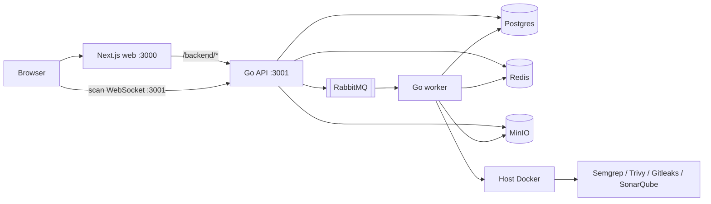
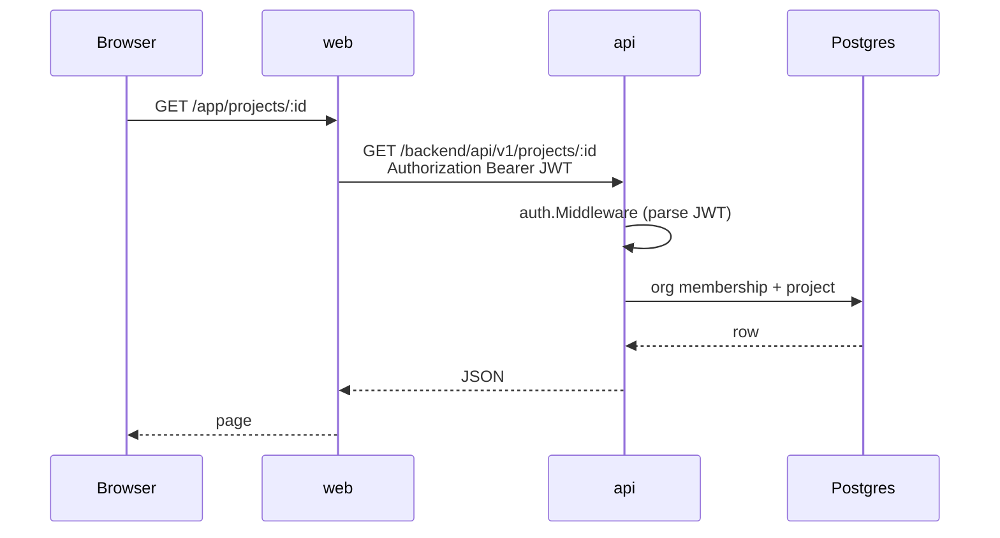
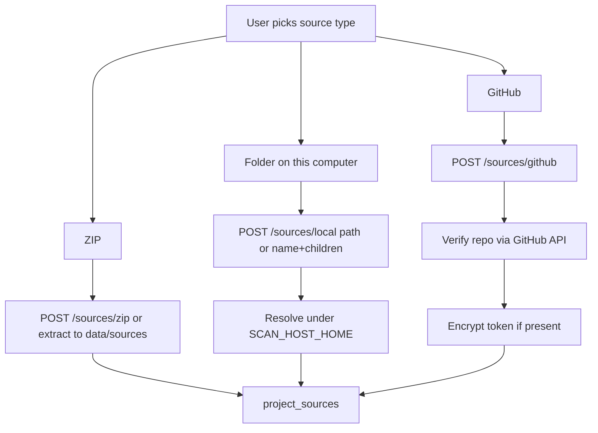
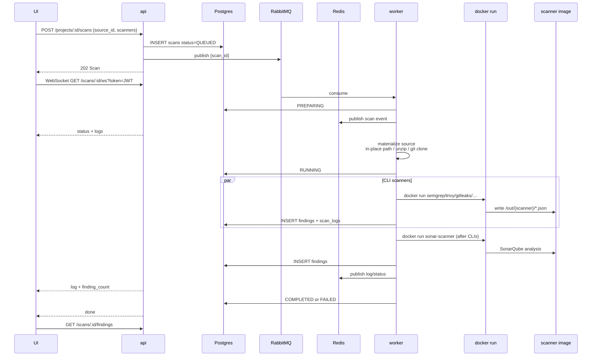
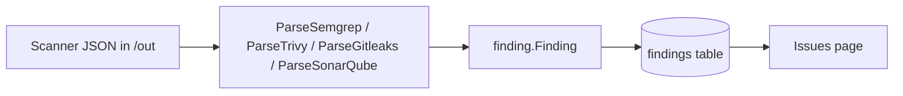
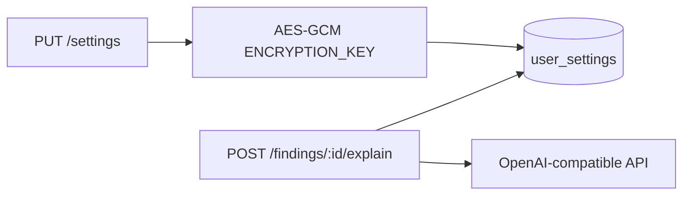

# Data flow

How data moves for a developer joining the project. Sequence is what you will see in the UI and in `docker compose logs -f api worker`.

## System context

The browser only reaches `web`. `web` rewrites `/backend/api/v1/...` to the API. Data stores are not published for the browser.

## Authenticated request

JWT is created on register/login and stored in `localStorage` (`bugcodeshield_token`). Send it on every product API call.

## Add source

Three kinds. All produce a `project_sources` row the scan will use.

- **Local folder:** no full tree upload. The API stores the **host path**. The scanner later mounts that path as `/src:ro`.
- **GitHub:** token may come from the request or from **Settings** (`user_settings`). Clone happens in the worker, not in the browser.
- **ZIP:** stored in MinIO or extracted under `data/sources/{id}/src`.

## Scan pipeline

The scan page opens a WebSocket to the API host (`ws://127.0.0.1:3001`). RabbitMQ stays the job queue; Redis fans worker log/status events out to API sockets. REST `GET /scans/:id` polling is only a fallback if the socket cannot connect.

Worker materialize rules (`internal/worker/worker.go`):

| `project_sources.kind` | What the worker does | `hostSrc` for Docker |
| --- | --- | --- |
| `local` (or zip with `local_path`) | Scan in place | the stored host path |
| `zip` / `files` without local path | Download from MinIO, extract to `data/scans/{id}/src` | that workspace |
| `github` | `git clone --depth 1` into workspace | that workspace |

## Finding ingest

Parsers live in `internal/scanning/normalize.go`. Fingerprint uniqueness is `(scan_id, fingerprint)`.

## Settings and AI

Ask AI uses the user's saved OpenAI key first, then `OPENAI_API_KEY` from the environment. No key → `ai_disabled` and the UI points at Settings. The model must not apply code changes.

## Where logs go

| You see | Stored as |
| --- | --- |
| UI scanner log panel | `scan_logs` rows (`scanner`, `level`, `message`) |
| `docker compose logs worker` | worker slog (job received, clone failed, …) |
| `docker compose logs api` | HTTP access log |

When debugging a failed Trivy/Semgrep run, read **both** the UI log and worker logs. The UI text is sanitized (tokens stripped, truncated).
