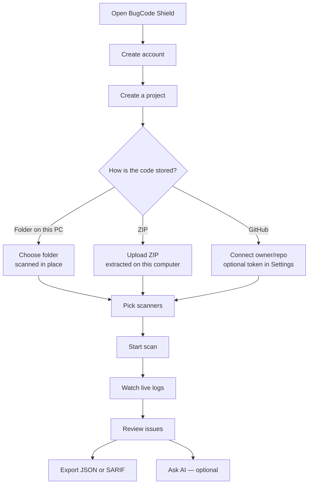

# User guide

How a new person uses BugCode Shield to scan **their** project. The same path is on the site at http://localhost:3000/guide.

Open the app at http://localhost:3000 (after `./scripts/start.sh`).

## Visual flow

What you should see on screen:

| Step | Page | You do this | You know it worked when |
| --- | --- | --- | --- |
| 1 | `/register` | Name, email, password (8+ characters) | You land on **Projects** |
| 2 | `/app` | New project name (and optional description) | The project card appears; click it |
| 3 | `/app/projects/:id` | Add source: folder, ZIP, or GitHub | The selected location is shown |
| 4 | Same page | Tick Semgrep / Trivy / Gitleaks (SonarQube and Dependency-Check are optional) | **Start scan** is enabled |
| 5 | `/app/projects/:id/scans/:scanId` | Wait | Live log fills over WebSocket; status is `COMPLETED` |
| 6 | Same page | Open an issue | File, line, and snippet appear |

## 1. Create an account

1. Click **Get started** (or go to `/register`).
2. Enter name, email, and a password of at least 8 characters.
3. Submit. BugCode Shield creates your user and a default organization.

Already registered? Use **Sign in**.

## 2. Create a project

On **Projects**, use **New project**. A project is only a name until you attach source. Click the card to open it.

## 3. Point it at your code

On the project page, **Saved locations** lists folders you already connected. Select one and click **Start scan**. Do not add the same folder again — that does not make analysis faster.

To attach code the first time, under **Add source code**, pick one option.

### Folder on this computer (usual path)

Use this when the repo already lives on the same machine as BugCode Shield.

1. Choose **Scan a folder on this computer**.
2. Click **Choose folder** and pick the project directory.
3. Wait until the **Selected folder** card shows the folder name (large trees can take a while).
4. If several folders share that name, pick the full path.
5. Or use **Or paste a full path** (example: `/home/you/projects/my-app`).

The folder is **not uploaded**. Scanners mount that path read-only. The path must sit under your home directory (`SCAN_HOST_HOME`).

### ZIP

1. Choose **Upload a ZIP**.
2. Select the archive and click **Add ZIP**.
3. Wait through upload, then extract.

### GitHub

1. Choose **Connect a GitHub repository**.
2. Paste `owner/repo` or the GitHub URL, and the branch (default `main`).
3. Public repos need no token. Private repos need a token here or in **Settings** (profile menu).
4. Click **Connect repository**. The confirmed URL appears when GitHub accepts it.

Save a GitHub token once in **Settings** if you scan private repos often.

## 4. Pick scanners and start

Default tools:

| Tool | What it looks for |
| --- | --- |
| Semgrep | Insecure code (SAST) |
| Trivy | CVEs, misconfig, some secrets |
| Gitleaks | Secrets in files and git history |
| SonarQube | Optional quality, bugs, and security hotspots (server at http://localhost:9002) |
| Dependency-Check | Optional, slower SCA |

Click **Start scan**. You are sent to the scan page. Issues are hidden until every selected tool finishes.

## 5. Watch the scan

You should see:

- Status: `QUEUED` → `PREPARING` → `RUNNING`
- Each tool: waiting → running → done
- **Live log** lines from the worker

Use **Cancel** if you pointed at the wrong folder. When status is `COMPLETED`, the page switches to **Issues**.

First time: scan `testdata/vulnerable-sample` in this repo so you know the dashboard can show findings.

## 6. Review issues

- **Issue groups** — security hotspot, vulnerability, infrastructure, secret leak, duplication, and code quality. Each card shows the count and which scanner found those issues. Click a group to filter.
- Severity counts (critical → info) — click a count to filter
- Scanner buttons — Semgrep, Trivy, Gitleaks, SonarQube, Dependency-Check
- **File directory** on the left
- Issue list in the middle, grouped by category; click one
- Detail on the right: category, scanner, file, line, snippet, remediation

Export with **JSON** or **SARIF**.

**Ask AI to explain** needs an OpenAI key in **Settings**. The model explains a finding; it does not change your source.

## 7. Settings (optional)

Profile menu (icon, top right) → **Settings**:

- GitHub token — private clones
- OpenAI API key — Ask AI

Tokens are encrypted. The UI only shows a hint after save, not the full secret.

## What not to expect

- BugCode Shield does not run your app, `npm install`, or tests on the host.
- A local folder scan does not upload the whole tree.
- Ask AI never applies a patch for you.

If a scan finishes with **0 issues**, the tools found nothing in **that** location. Attach the application folder (not an empty or unrelated directory) and start a new scan.
